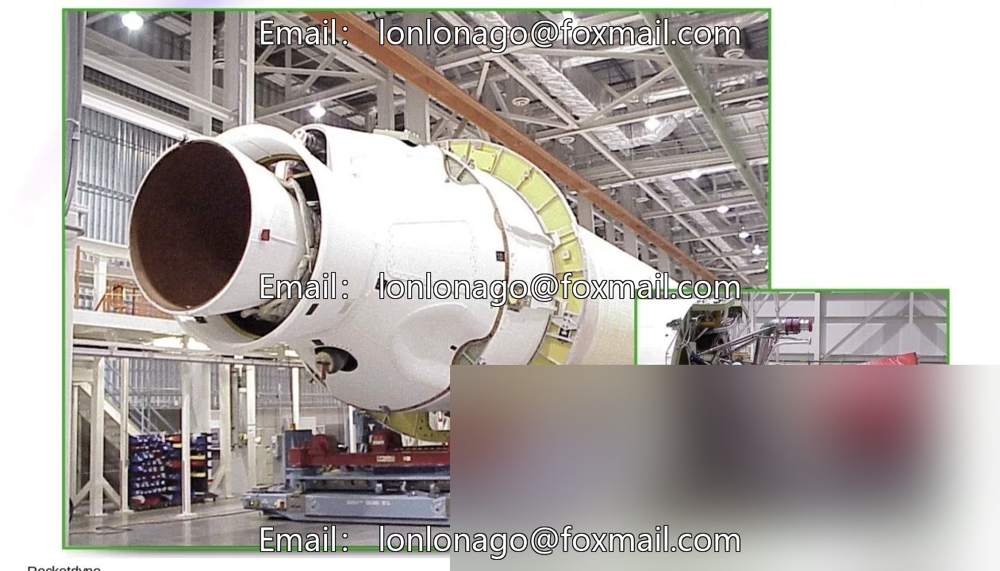
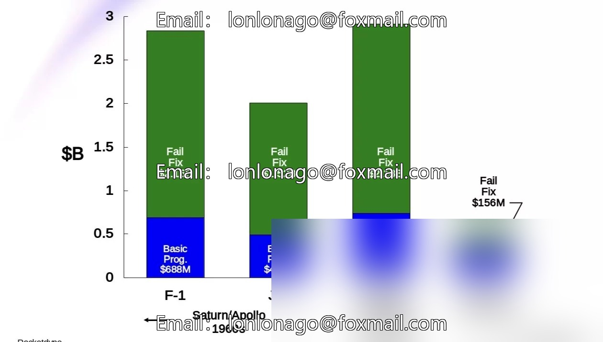
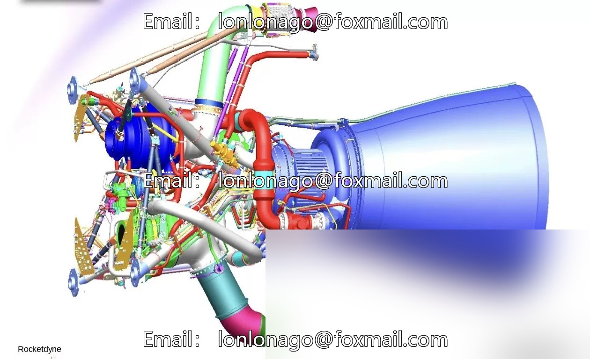

# RS-68 rocket engine technical introduction slide

## Body

RS-68 rocket engine technology introduction slides
PPT format, approximately 25 pages, covering design concepts, working principles, operational characteristics, etc., suitable for learning and reference related to aerospace and rocket technology.
directly drive link.
325558850-Pro

This is a RS-68 rocket engine technical introduction slide, covering design philosophy, working principles and operational characteristics; the format is PPT with approximately 25 pages and suitable for space and rocket technology learning references.

<!-- AI_ENRICHED -->

## Images

## Payment

Here is a pay link on Stripe ( https://buy.stripe.com/3cs8yP7sY87d0vu9AB ). Please contact me lonlonago@foxmail.com after funding $89, and I will send you a complete data files , thank you!

